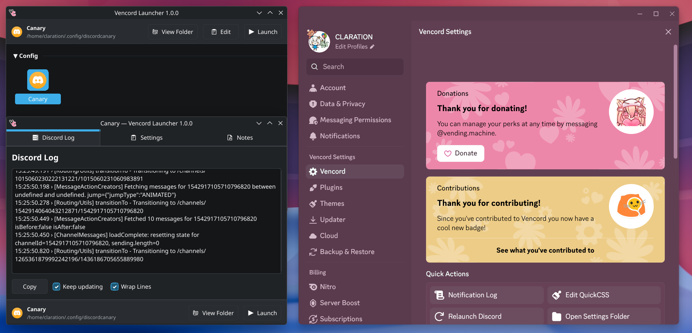

# Venject

[](https://github.com/claration/venject/releases)
[](https://github.com/claration/venject/releases)
[](https://github.com/claration/venject/blob/main/LICENSE)
[](https://github.com/sponsors/claration)

Venject is a mod launcher for Discord, primarily used for with [Vencord](https://github.com/Vendicated/Vencord) automatically installed!



### Features
- User friendly and clean UI.
- Customizable existing Discord instances.
  - Specify custom launch arguments.
  - Specify custom Vencord installation paths.
- Add custom shortcuts that automatically launch Discord with Vencord.
- View Discord's normally hidden logs.

## Download

Visit [releases](https://github.com/claration/venject/releases) and get the latest version for your computer.

## Building

Building is going to be a bit convoluted for each platform, each having their own unique specifications, but the best reference for building should be looking at how [GitHub actions](./.github/workflows/build.yml) does it.

### Debian / Ubuntu Linux

For packaging an AppImage, you're gonna need to do some extra steps outside of the package manager, you can see [here](https://github.com/claration/venject/blob/trunk/.github/workflows/build.yml#L16-L23) on how to do that.


```sh
sudo apt install -y \
    build-essential \
    cmake \
	qt6-base-dev \
    qt6-declarative-dev \
    qt6-tools-dev \
    qt6-svg-dev
```

### Windows

- [MSYS2](https://www.msys2.org/)

```sh
pacman -S \
    git \
    mingw-w64-x86_64-toolchain \
    mingw-w64-x86_64-cmake \
	mingw-w64-x86_64-nsis \
	mingw-w64-x86_64-qt6-base \
	mingw-w64-x86_64-qt6-declarative \
	mingw-w64-x86_64-qt6-tools \
	mingw-w64-x86_64-qt6-svg \
    make \
    patch
```

### Compiling

```sh
# Linux / Windows
make
# Compile then package for AppImage / NSIS
make package
```

## Translating

Venject has translation support (pretend I eplain how you can translate.)

## Sponsors

| Thanks to all my [sponsors](https://github.com/sponsors/claration)!! |
|:-:|
|  |
| _**"samara is cute" - Vendicated**_ |

## Acknowledgements

- [CLARATION](https://github.com/claration) – The maker.
- [Instellate](https://github.com/Instellate) – Windows support & QT stuff.
- [Paige](https://github.com/ssalggnikool) – Fixes & QT stylistic choices.
- [Megumin](https://github.com/MeguminSama/Electron-Hook) – Injection references.


## License

This project is licensed under the GPL-3.0 license. You can see the full details of the license [here](https://github.com/claration/venject/blob/main/LICENSE). 

By contributing to this project, you agree to license your code under the GPL-3.0 license as well (including agreeing to license exceptions), ensuring that your work, like all other contributions, remains freely accessible and open.
